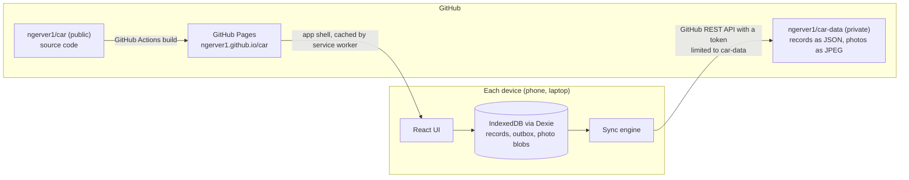

# R35 Maintenance Log App — Build Spec

Nov 15, 2026 · @Nick · Revision 2 (hosting and sync moved to GitHub)

## Changes in revision 2

| Area | Revision 1 | Revision 2 |
| --- | --- | --- |
| Hosting | Cloudflare Pages | GitHub Pages from the public code repo `ngerver1/car`, deployed by GitHub Actions |
| Sync and backup | Supabase (Postgres, Auth, Storage) | A private data repo `ngerver1/car-data`: one JSON file per record, photos as JPEG files, written and read by the app through the GitHub API |
| Sign-in | Supabase magic link | A fine-grained GitHub token limited to `car-data`, pasted once per device |
| Pull cursor | Server `updated_at` timestamp | Last commit seen in `car-data` |
| Ref blocks | Assigned by the server | Claimed in `car-data/devices.json` by commit |
| Engine oil interval | 3,000 km or 5,000 km (open) | Owner confirmed 5,000 km / 12 months |
| Severity scale | Open question | Confirmed: Safety-critical / Drivability / Reliability / Cosmetic |
| ESM group count | "14 groups" | 14 ESM groups (A, B, D–N, P) plus Z = 15 active groups, plus C and O as inactive legacy groups |

Build status at this revision: milestones 1–3 are done; hosting (part of milestone 1) is being added now.

## Overview

Build a single-user, offline-first web app (installable PWA) that replaces `Maintenance_Log.xlsx` for one car: a 2008 JDM Nissan GT-R, chassis code CBA-R35. It must log defects and their troubleshooting chains, record servicing, track what is due by km and date, keep a register of fitted parts, and produce a shortlist of defects to hand a workshop. Every device works offline and syncs through a private GitHub repo when back online.

**What replaces what in the spreadsheet**

| Spreadsheet | App |
| --- | --- |
| Master sheet: one row per entry, chained by "Opening Entry of Chain" | Separate records: Defects and Jobs, each with child Steps; Service Records for routine servicing |
| Type column (Info, Task, Defect, Work Order, Trouble Shooting, Parts Order) | Record kind (Defect / Job / Service Record) plus Step type (Troubleshooting / Observation / Parts Order / Rectification) |
| Open/Cont/Close | Defect status: Open, In progress, Deferred, Closed |
| Chapters sheet (A–P, Z) | ESM groups and sections from publication SM13E00-1R35E0E |
| Part Name, Cost, Parts currently on car | Part lines on steps and service records; Installed Parts register |
| RMK (Comments, currently blank) | Free-text Comments field on every step |
| Expiry Int / Expiry Date formulas | Service Items with intervals; due dates calculated |
| Dashboard: open items, due list, task list | Dashboard screen and Shortlist builder |
| IsTitleOpen, Is Chain Open, Opening Entry of Chain, array formulas | Not stored: replaced by real relationships and calculated status |

**Out of scope for v1:** more than one vehicle, other users or workshop logins, sending email from the app, OBD/scan-tool integration, and reading the ESM PDF itself.

## Reference standards and terminology

The app's chapter list is the Quick Reference Index of Nissan ESM publication SM13E00-1R35E0E (R35 series, © 2013 Nissan International SA), supplied by the owner. It is held as editable reference data, seeded exactly as below. Each defect carries one group (required) and at most one section (optional), and the section belongs to that group.

| Group | Group name (ESM) | Sections: code and name |
| --- | --- | --- |
| A | General Information | GI General Information |
| B | Engine | EM Engine Mechanical · LU Engine Lubrication System · CO Engine Cooling System · EC Engine Control System · FL Fuel System · EX Exhaust System · STR Starting System · ACC Accelerator Control System |
| D | Transmission & Driveline | TM Transaxle & Transmission · DLN Driveline · FAX Front Axle · RAX Rear Axle |
| E | Suspension | FSU Front Suspension · RSU Rear Suspension · SCS Suspension Control System · WT Road Wheels & Tires |
| F | Brakes | BR Brake System · PB Parking Brake System · BRC Brake Control System |
| G | Steering | ST Steering System · STC Steering Control System |
| H | Restraints | SB Seat Belt · SR SRS Airbag · SRC SRS Airbag Control System |
| I | Ventilation, Heater & Air Conditioner | VTL Ventilation System · HA Heater & Air Conditioning System · HAC Heater & Air Conditioning Control System |
| J | Body Interior | INT Interior · IP Instrument Panel · SE Seat |
| K | Body Exterior, Door, Roof & Vehicle Security | DLK Door & Lock · SEC Security Control System · GW Glass & Window System · PWC Power Window Control System · HD Hood · EXT Exterior · BRM Body Repair |
| L | Driver Controls | MIR Mirrors · EXL Exterior Lighting System · INL Interior Lighting System · WW Wiper & Washer · DEF Defogger · HRN Horn |
| M | Electrical & Power Control | PWO Power Outlet · BCS Body Control System · LAN LAN System · PCS Power Control System · CHG Charging System · PG Power Supply, Ground & Circuit Elements |
| N | Driver Information & Multimedia | MWI Meter, Warning Lamp & Indicator · WCS Warning Chime System · AV Audio, Visual & Navigation System |
| P | Maintenance | MA Maintenance |
| Z | Other (owner-defined) | none |

That is 14 ESM groups with 54 sections, plus the owner's group Z.

**Two groups in the spreadsheet are not in this ESM.** C (Electrical Power Train) and O (Cruise Control and Driver Assistance) are not in the R35 index. Seed them as inactive legacy groups so imported rows keep their tag, and offer to re-tag them. For example, cruise control (ASCD) on the R35 is covered in EC Engine Control System. The owner confirms the re-tags during import review.

**Terminology rules for the UI and seed data**

- Use the ESM's names and codes exactly as printed, including Nissan spellings such as "Tires" and "Transaxle". Show the code with the name ("TM · Transaxle & Transmission") everywhere a chapter appears.
- Vehicle identity: model code CBA-R35 (the 2007–2010 JDM emissions prefix; later cars are DBA-, 4BA- and 3BA-R35), engine VR38DETT, transmission GR6 dual-clutch transaxle (BorgWarner GR6Z30A). Distances are always km and volumes litres; every cost carries its own currency.
- Abbreviations offered in pick-lists and help text: DTC (diagnostic trouble code), TCM (transmission control module), ECM (engine control module), MVB (main valve body), CVB (clutch valve body), DCT (dual-clutch transmission), ASCD (cruise control), VDC (vehicle dynamic control).
- This ESM edition is a 2013 European publication. The section structure applies to the 2008 car, but its specifications and intervals may differ from the 2008 JDM car. Any spec copied from it is labelled with its source, and owner overrides always win.

**ESM links:** each section can store a link to the owner's copy of the ESM (file URL or path, plus a page number). A defect's chapter chip opens that link. The app never stores or redistributes ESM content, and the ESM PDF is never committed to either repo.

## Architecture

A React + TypeScript PWA with a local IndexedDB database (Dexie) as the source of truth. The app is hosted on GitHub Pages from the public code repo. Each device syncs its records and photos with a private data repo through the GitHub REST API. There is no server code and no account other than the owner's GitHub account.



The UI only ever talks to the local store, so it never waits on the network. The sync engine moves records and photos in the background.

**Two repos, on purpose.** `ngerver1/car` is public so GitHub Pages hosts it for free; it holds only code, seed data and docs. Everything about the car's history (records, photos, costs, the spreadsheet) lives in the private `ngerver1/car-data`. The app refuses to sync with a data repo that GitHub reports as public.

| Layer | Choice | Why |
| --- | --- | --- |
| App | Vite + React + TypeScript, vite-plugin-pwa (Workbox) | Installable on iPhone, Android and desktop; app shell cached for offline start |
| UI | Tailwind CSS + Radix primitives | Accessible forms and sheets that work well on a phone |
| Local data | Dexie (IndexedDB) + dexie-react-hooks | Live queries keep screens current; large photo blobs fit |
| Validation | zod | One schema for forms, local store, sync payloads and import |
| Hosting | GitHub Pages, deployed by a GitHub Actions workflow on push | Free for a public repo, HTTPS (which service workers need), no extra account |
| Sync and backup | Private GitHub repo `car-data`, written with the Git Data API (blobs, trees, commits, refs) | One account; every change is a commit, so full history and restore come free; data stays readable as plain JSON |
| Auth | Fine-grained personal access token: repository access `car-data` only, permission Contents read and write | No server needed; the token cannot reach any other repo |
| PDF | @react-pdf/renderer (or pdf-lib) on the device | Work orders build offline |
| Spreadsheet import | SheetJS (xlsx) on the device | Parses the owner's file without uploading it |
| Tests | Vitest (domain logic, sync engine against an in-memory fake of the GitHub API), Playwright (flows, offline mode, two-device sync against the fake) | Covers the due calculation and the two-device sync test without touching real data |

Alternatives considered: Supabase plus Cloudflare Pages (revision 1) gives instant sync and magic-link sign-in but needs two more accounts and their free tiers. PowerSync, ElectricSQL or RxDB add a dependency and cost one user doesn't need. Making `car` private and paying for GitHub Pro would allow one repo, at about US$4 a month. Self-hosting over Tailscale fails on iOS, which needs trusted HTTPS for service workers.

## Data model

One Defect or Job has many Steps. A Step or Service Record has many Part Lines and Photos. A fitted Part Line creates an Installed Part. Every synced table has the sync columns listed at the end of this section.

**Vehicle** (one row): nickname, model code (CBA-R35), VIN/chassis number, engine (VR38DETT), transmission (GR6), registration, purchase date, purchase odometer (km), ESM publication number, notes.

**Group** and **Section** (reference data): code, name, sort order, active flag, source (`ESM SM13E00-1R35E0E` or `owner`), ESM link and page. A Section belongs to one Group.

**Vendor**: name, kind (Workshop / Supplier / Both), phone, email, address, notes, review flag. Seeded from the sheet: Private Corner, Pit Station, Jacks Trans, JustJap, and "Circlip Order" (flagged for review: it looks like an order rather than a vendor).

**Settings** (one row, synced): due-soon km and days, default currency.

**Issue**: one table with `kind` = `defect` or `job`. A job is planned work that is not a fault, such as the dashcam install (#10) or the upgraded tail lights (#64).

| Field | Type | Defect | Job | Notes |
| --- | --- | --- | --- | --- |
| ref\_no | integer, unique | required | required | Shown as D-0009 / J-0010 (prefix from kind). Imported rows keep their sheet entry number |
| title | text ≤ 120 | required | required |  |
| description | long text | optional | optional |  |
| date\_identified | date | required | required |  |
| odo\_identified | integer km | optional | optional | Warn if lower than an earlier reading |
| group\_code | ref Group | required | required |  |
| section\_code | ref Section | optional | optional | Must belong to group\_code |
| severity | enum | required | none | Safety-critical / Drivability / Reliability / Cosmetic |
| status | enum | required | required | Open / In progress / Deferred / Closed |
| how\_found | enum | required | none | Driver / Workshop inspection / Scan tool / During service / Other |
| found\_by\_vendor | ref Vendor | optional | none |  |
| symptom | object | optional | none | rpm\_from, rpm\_to, gears (multi: P, R, N, 1–6), speed\_from/to km/h, engine\_state (Cold / Warm / Hot), load (multi: Idle / Cruise / Accel / Decel / Uphill), frequency (Always / Intermittent / Once), notes |
| dtcs | list | optional | none | Each: code (e.g. P0300), module (ECM / TCM / ABS-VDC / Other), status (Current / Past / Cleared), date read |
| deferred\_reason | text | when Deferred | when Deferred |  |
| closed\_date, closed\_odo | date, km | when Closed | when Closed |  |
| closing\_note | long text | required to close | required to close |  |
| legacy\_entry\_no | integer | import only | import only |  |

**Step** (troubleshooting): issue\_id (required), seq (ordered), date, odo (km), step\_type (Troubleshooting / Observation / Parts Order / Rectification), vendor\_id, details (required), comments (the sheet's RMK), outcome (Fixed / Not fixed / Inconclusive / none), severe\_use (the "track / high oil temp" tag), legacy\_entry\_no. An outcome of Fixed asks: "Close this defect?" and pre-fills the closing note from the step's details. Adding the first step to an Open issue moves it to In progress.

**Service Item** (the schedule): name, group/section, interval\_km, interval\_months, rule (whichever comes first), severe\_km and severe\_months (optional, used after a "track / high oil temp" record), seed\_km, seed\_months, seed\_source (text + URL), fluid or part spec, capacity (L), active flag, notes. Owner overrides are written to interval\_km / interval\_months; the seed values stay alongside.

**Service Record**: date, odo (required), vendor\_id, items performed (many Service Items), notes, linked\_issue\_id (optional), severe\_use. Saving one resets the due point of each item performed.

**Part Line**: belongs to one Step or one Service Record. part\_name (required), part\_number (e.g. 01553-05933), brand, qty, cost (decimal), currency (ISO code, default AUD, set per line), order\_status (Ordered / Received / Fitted / Returned / n/a), fitted (bool), position (e.g. LF, RR, Both).

**Installed Part**: created when a Part Line is marked fitted. part\_line\_id, fitted\_date, fitted\_odo, position, replaces\_installed\_part\_id, removed\_date, removed\_odo, active (current = not removed).

**Photo**: parent (Issue, Step or Service Record), caption, taken\_at, width, height, bytes, thumbnail (320 px JPEG data URL, stored on the record), local\_blob\_key, remote\_path (`photos/<id>.jpg` in `car-data`), upload\_state (Pending / Uploaded / Failed).

**Shortlist**: name, vendor\_id, created\_date, notes, items (ordered list of issue ids), exported\_at, snapshot. Exports take a snapshot so the PDF stays reproducible after defects change.

**Odometer Reading**: date, km, source (the record it came from, `purchase`, or Manual). Current odometer = the latest reading by date (highest km on ties).

**Sync columns on every synced table:** id (UUID v7, created on the device; seed rows use fixed UUID v5 ids so every device seeds the same rows), created\_at, updated\_at (device time when the change was committed to `car-data`; null until first synced), updated\_by\_device, deleted (soft-delete flag), version (integer, +1 per edit).

**Device-local data (never synced):** device id, ref block, GitHub token, data repo name, last pulled commit, the index of remote file versions (path → blob SHA), the outbox, photo blobs, conflicts and form drafts.

## Screens and forms

Eight screens, phone-first: one column under 640 px, two columns on tablet and desktop. Bottom tab bar on phone: Dashboard, Defects, Service, Parts, More. A sync indicator sits in the header on every screen: Synced / Offline · n pending / Syncing / Error / Sync not set up · n pending.

1. **Dashboard**: tiles for current odometer, km per year, and open defects by severity. Then the due list (each Service Item: next due km and date, km and days remaining, projected due date, coloured Overdue / Due soon / OK), the open issues list, and a "Build shortlist" button. Due soon = within 1,000 km or 30 days (both editable in Settings). km per year = (current km − purchase km) ÷ days since purchase × 365. That replaces the sheet's hard-coded 74,700 with the vehicle's purchase odometer.
2. **Defects list**: filters for status (default: everything not Closed), kind, severity, group and vendor, plus full-text search over title, description, steps and DTCs. Each row shows ref, title, group/section chip, severity, status, last step date and days open.
3. **Defect setup** (new defect, a separate form from steps): title, date identified (default today), odometer (default current), group (required) then section (filtered by group, optional), severity, how found, found by, description, then a collapsible "Symptom conditions" block (rpm range, gears, speed range, engine state, load, frequency, notes), a DTC list (add rows), and photos (camera or library, several at once). Save creates the defect with status Open. A "New job" variant hides severity, symptoms, DTCs and how found.
4. **Defect detail**: header with everything from setup plus status controls. Below it, the step timeline (oldest first, toggle newest first), each step showing type, date, km, vendor, details, outcome, parts with costs, photo thumbnails and comments. Footer shows total cost, grouped by currency (never summed across currencies). Actions: Add step, Change status (Deferred needs a reason, Closed needs a closing note, and both store date and km), Add to shortlist, Edit, Delete (soft, with confirmation).
5. **Troubleshooting step form**: date (default today), odometer, step type, vendor (pick, or add a new vendor inline), details (required), outcome, comments, "track / high oil temp" tag, photos, and a repeatable part lines block (part name, part number, brand, qty, cost, currency, order status, fitted, position). Marking a line fitted asks which installed part it replaces, if any.
6. **Service**: the Service Items list (interval, last done, next due, seed vs override) with an Edit interval sheet that shows the seed value and its source next to the override. Plus the Service Records list and a New service record form: date, km, vendor, a checklist of items performed, part lines, photos, notes, and link to an issue.
7. **Parts**: an Installed Parts register (current by default, toggle to show removed). Columns: part, part number, brand, position, fitted date and km, km since fitted, and source step. Plus a Parts on order view (part lines with order status Ordered or Received).
8. **Shortlist builder and export**: tick open issues (from the dashboard or the defects list), drag to order, pick the vendor and add notes. Then two outputs:
   - **PDF work order** (A4 portrait): vehicle block (CBA-R35, VIN, current km, date), a numbered table per issue (ref, title, group/section, severity, symptom summary, DTCs, last step summary, up to 2 photo thumbnails), a notes block, and blank "Workshop findings" lines. Generated on the device so it works offline; shared through the system share sheet or downloaded.
   - **Copy as text**: plain text, one issue per numbered line (`1. D-0065 Shudder 1st/2nd at ~1250 rpm [D › TM] — Drivability`), with a vehicle header line, ready for SMS or WhatsApp.

**More** holds Settings (vehicle, vendors, groups and sections with ESM links, due-soon thresholds, default currency, storage status, export and backup), **Sync setup** (data repo name, token, Test connection, Disconnect this device), the Import tool, and the Sync log.

**Form behaviour everywhere:** drafts save locally as you type, so nothing is lost if the app closes. Odometer entries lower than the previous reading need confirmation. Dates default to today in the device time zone (Australia/Brisbane for the owner). Number inputs use the numeric keyboard. Every form works offline.

## Service schedule

Each Service Item's next due point = its last Service Record (or an imported entry) + interval, whichever comes first by km or by months. With no record yet, count from the purchase date and purchase km (2026-03-25, 74,689 km). Projected due date for the km limit = today + km remaining ÷ (km per year ÷ 365). An item with an interval left blank is "Set interval" and is never shown as due.

Seed values are for the 2007–2010 JDM car where Nissan Japan publishes them. Where no verified value was found the interval is left blank for the owner to set from ESM section MA. Owner overrides are applied over the seed.

| Service Item | Section | Seed interval (source) | Owner override | Spec / capacity |
| --- | --- | --- | --- | --- |
| Engine oil + oil filter | LU / MA | 15,000 km or 12 months, oil temp below 110°C; 5,000 km at 110–130°C; change straight after driving above 130°C ([Nissan Japan FAQ 9032](https://faq2.nissan.co.jp/faq/show/9032)) | **5,000 km / 12 months** (owner confirmed 2026-11-15; entry #4 had 3,000 km, the Dashboard implied 5,000 km) | Mobil 1 0W-40, API SM; about 5.5 L with filter (owner now runs Motul 300V 5W-40) |
| Transmission oil (GR6) | TM | 30,000 km for JDM cars; Nissan later extended this to 60,000 km in Japan if oil stays below 110°C, and 5,000 km at 110–140°C ([CarAdvice](https://www.caradvice.com.au/news/nissan-loosens-grip-on-gt-r-servicing/)). Seed 30,000 km, months blank | none; entry #21 sets a +500 km post-service check | Nissan R35 Special transmission oil, about 9.7 L ([FAQ 9034](https://faq2.nissan.co.jp/faq/show/9034)); owner uses Motul DCTF |
| Front + rear differential oil | DLN | Same as transmission oil (same source) | 60,000 km (entry #34) | 75W-140 API GL-5; front about 0.65 L, rear about 1.55 L (FAQ 9034) |
| Brake fluid | BR | blank: no JDM interval found | 20,000 km (entry #7) | Nissan Brake Fluid R35 Special, DOT4 (FAQ 9034) |
| Engine coolant | CO | blank | none | Nissan Long Life Coolant, about 11.0 L including reservoir (FAQ 9034) |
| Spark plugs | EM | blank; replace any plug whose gap reaches 1.0 mm ([Nissan SA schedule](https://www.nissan.co.za/content/dam/Nissan/za/Maintenance/GTR.pdf)) | none (NGK Racing heat range 8 fitted 2026-05-27, #22) | Iridium (factory) |
| Air cleaner filter | EM / MA | blank | none |  |
| Air con filter | VTL | blank | none |  |
| Brake hoses (inspect) | BR | blank | none (open item #46) |  |
| Power steering fluid | ST | blank | none | Nissan PSF, about 1.1 L (FAQ 9034) |
| Transmission settings, clutch and shift fork inspection | TM | blank; Nissan lists this as a GT-R special inspection | none |  |
| Wheel alignment | FSU / RSU | blank | none |  |

The sheet's due list item "Oil Filter" folds into "Engine oil + oil filter". "TM Oil" becomes Transmission oil, and "Diff Fluid" becomes Front + rear differential oil.

**Severe-use rule:** each item can hold an optional severe-use interval (as for oil above 110°C). A Service Record or step can be tagged "track / high oil temp", which makes the next due point use the severe interval.

## Hosting

1. The app is built and deployed by a GitHub Actions workflow (`.github/workflows/deploy.yml`) on every push to the repo's default branch. It runs the unit tests, builds with base path `/car/`, and publishes `dist/` with the official Pages actions.
2. The site is `https://ngerver1.github.io/car/`. The PWA manifest's `start_url` and `scope` are `/car/`, and the router uses `/car/` as its base.
3. GitHub Pages has no rewrite rules, so the build copies `index.html` to `404.html`. A deep link such as `/car/defects/123` therefore loads the app, and the service worker serves deep links offline after the first visit.
4. One-time setup by the owner: repo Settings → Pages → Source: **GitHub Actions**.
5. A new deploy reaches each device the next time the app is opened with signal (the service worker updates itself).

## Offline and sync rules

The device's local database is the app's source of truth. The private `car-data` repo is the sync hub and the backup. Every read and write in the UI hits the local store only, so the app behaves the same online and offline.

### The data repo

The owner creates `ngerver1/car-data` as a **private** repo with a README (GitHub's API cannot write to an empty repo). The app writes this layout on its default branch:

```
car-data/
  README.md              what this repo is (written once by the app)
  devices.json           device id → name and ref block
  vehicle/<id>.json      one file per record, named by the record's UUID
  settings/<id>.json
  groups/<id>.json       only seed rows that were edited are ever written
  sections/<id>.json
  vendors/<id>.json
  issues/<id>.json
  steps/<id>.json
  serviceItems/<id>.json
  serviceRecords/<id>.json
  partLines/<id>.json
  installedParts/<id>.json
  shortlists/<id>.json
  odometerReadings/<id>.json
  photos/<id>.json       photo record (caption, size, thumbnail)
  photos/<id>.jpg        the full-size photo
  imports/               optional: the owner's original spreadsheet, kept private
```

Each record file is the record's JSON, keys sorted and pretty-printed, so git diffs read well. Deletes are soft: the file stays, with `"deleted": true`.

### Device setup

1. The owner creates a fine-grained personal access token on GitHub: Repository access → Only select repositories → `car-data`; Permissions → Contents: Read and write. The token is pasted into More → Sync setup on each device and stored only in that device's IndexedDB.
2. Test connection checks that the token works, that the repo exists, and that GitHub reports it as **private**. The app refuses to sync with a public data repo.
3. The first successful sync claims a ref block by adding the device to `devices.json` in a commit (blocks go 1, 2, 3…; device 1 issues refs 1000–1999, device 2 issues 2000–2999). If two devices claim at once, the losing commit is rejected and that device re-reads the file and claims the next block.
4. A device that created issues before it had a block used block 1 by default. If its claim gives it another block, its not-yet-synced issues are renumbered into the new block before they are pushed, so no other device has seen the old numbers.
5. Disconnect this device deletes the token from the device. Losing a phone means revoking the token on GitHub (and making a new one for the other devices).

### Local store and writes

1. **Local store:** IndexedDB through Dexie, one table per entity plus `outbox`, `photo_blobs`, `conflicts` and `meta` tables. On first launch, call `navigator.storage.persist()` and show a warning in Settings if it is refused. Without that, iOS Safari can evict storage.
2. **Writes:** each write updates the record locally (version + 1, `updated_by_device`) and appends an outbox entry in the same transaction: `{record_table, record_id, version, op: upsert|delete, payload, queued_at}`.

### Sync cycle

A sync runs when the app gains focus, on the `online` event, every 60 s while open, after a write (debounced by a few seconds), and by Background Sync where the browser supports it. Each cycle is **pull, then push**, then photos.

1. **Pull.** Read the head commit of the default branch. If it equals the device's last pulled commit, skip. Otherwise read the head's tree (recursive) and compare each path's blob SHA with the device's index. Download only changed record files (several at a time). Apply each one by the conflict rule below. Skip `photos/*.jpg`: photos download on demand. Then store the head commit as the last pulled commit and update the index.
2. **Push.** Take outbox entries oldest first in batches of 100 changes. For each batch, build one new tree on top of the head with the changed files written inline, make one commit (message such as `Sync from iPhone: 3 issues, 5 steps`) whose parent is the head the device just pulled, and move the branch to it without force. If GitHub rejects the move because another device committed first, pull again and retry the batch. Acknowledged entries leave the outbox, and each pushed record gets `updated_at` = the commit time.
3. **Conflicts:** last-writer-wins per record, by version, then `updated_at`, then device id. The losing version is not discarded: it is written to the local `conflicts` table and shown in the Sync log with a "Restore this version" action. Older versions can also be restored from the file's git history. Child records (steps, part lines, photos) are separate files, so two devices adding steps to the same defect never conflict.
4. **Photos:** resize on the device to a 2,048 px long edge, JPEG quality 0.8, strip location data, then keep the blob in `photo_blobs` until it is uploaded. Upload runs after the record push, one photo at a time, as a git blob, then the uploaded photos go in one commit at `photos/<id>.jpg`. Failures retry with backoff, and `upload_state` moves Pending → Uploaded (or Failed with a Retry). Other devices load the full photo on demand and cache it. Thumbnails (320 px) are made on the device and stored on the photo record, so they arrive with the normal pull.
5. **Rate limits:** GitHub allows 5,000 API calls an hour per token. A normal cycle with nothing new costs 1 call. The engine backs off when GitHub reports the limit is near.
6. **Status shown to the user:** pending outbox count, photos waiting to upload, last successful sync time, the last commit synced (linking to it on GitHub), and errors in plain words with a Retry button (for example "GitHub rejected the token. Make a new one and paste it in Sync setup.").
7. **Backup:** `car-data` is itself a full backup with history. "Export everything" in Settings also writes a ZIP of JSON (all tables) and the photos, made from the local store, so it works offline. Import of that ZIP restores a device. A new device can also restore by connecting to `car-data` and pulling.

Acceptance test: edit the same defect on two devices in airplane mode, add a step and a photo on each, then reconnect both. Both steps and both photos appear on both devices. The title shows the later edit, and the other title is in the Sync log.

## Spreadsheet import

The import runs in the app. The owner picks `Maintenance_Log.xlsx`, and it is parsed on the device with SheetJS (Master and Dashboard sheets). The app builds a preview of proposed records, the owner reviews every flag, and then everything is committed locally in one transaction and synced like any other change. Re-running is safe because `legacy_entry_no` is unique, so existing rows are skipped. The 66 Master rows (entries 2–67) are the input. Formula columns are ignored and their cached values are not trusted.

The spreadsheet must never be committed to the public `car` repo. If the owner wants to keep it, it goes in `car-data/imports/`. Tests use a synthetic workbook built from this spec.

**Column mapping (Master)**

| Column | Header | Goes to |
| --- | --- | --- |
| A, B | (unlabelled array formula), IsTitleOpen | dropped (calculated) |
| C | Entry Number | `legacy_entry_no`; for chain openers also the ref (D-0009) |
| D | Date | Issue.date\_identified or Step.date |
| E | Type | Record kind and step\_type, using the rules below |
| F | Chapter | Issue.group\_code; blank goes to Z, flagged |
| G | Open/Cont/Close | Issue status, using the rules below |
| H | Technician | Vendor (created on first use), on the issue (found\_by) or step |
| I | Opening Entry of Chain | Parent: I = C means an opener; otherwise a Step of issue I |
| J | ODO | odo, plus an Odometer Reading; blanks stay blank (never inferred) |
| K | Is Chain Open | dropped (calculated) |
| L | Entry Details | Opener: Issue.title. Child: Step.details |
| M | Part Name | Part Line.part\_name (e.g. "01553-05933 X20", "16 Plate", "24 TCM Ordered") |
| N | RMK | Step.comments (currently blank) |
| O | Cost | Part Line.cost; currency chosen per row at review (default AUD) |
| P / Q | Expiry Int / Expiry Date | Service Item override (the interval implied by the formula) and the last-done point |
| R | Parts currently on car | Part Line.fitted = true, plus an Installed Part |

**Type rules**

- Opener with Type Defect becomes a defect. Work Order (#10) becomes a job.
- Opener with Type Task becomes a defect if its text describes a fault, otherwise a job. The proposed kind is always flagged for the owner to confirm.
- Info opener #2 "Car Purchase Service" and its children #3–#8 become one Service Record (2026-03-25, 74,689 km, Private Corner, cost 11,700) covering transmission oil, engine oil + filter, front and rear differential oil, and brake fluid.
- Child rows: Trouble Shooting becomes Troubleshooting; Parts Order stays Parts Order; Defect becomes Observation; Task becomes Rectification when its status is Close, otherwise Troubleshooting.
- Status comes from the chain's last row by date: Close gives Closed (closing note = that row's details, flagged to review); Open or Cont gives In progress if the chain has steps, else Open.
- Chain #21 "Transmission Service Start" stays a job with its steps, and also creates Service Records on 2026-07-30 for transmission oil (#32), filters (#33) and differential oil (#34, 76,233 km).
- Entry #4's engine oil interval is replaced by the owner's confirmed 5,000 km / 12 months.

**Known flags (the review screen must show each one)**

- [ ] \#66 belongs to chain #64 (tail lights) but describes the shudder problem; propose moving it to #65.
- [ ] \#56, #60, #63, #65 are Task openers that are faults; propose defects. #64 and #67 are proposed as jobs.
- [ ] \#47 and #48 are typed Defect but sit under #40; propose Observation steps.
- [ ] Chapter blank on 48 of 66 rows, including 18 of the 27 chain openers (#14, #21, #40–#46, #50, #56, #57, #59, #60, #63–#65, #67); the owner picks group/section for each opener, and steps take the opener's.
- [ ] \#13 is tagged O (not in the ESM); propose EC. Any C tag gets the same treatment.
- [x] Engine oil interval: the Dashboard says due at 79,689 km, entry #4's formula gives 77,689 km. Resolved: the owner confirmed 5,000 km, so due at 79,689 km. The review screen still shows the difference for information.
- [ ] The 7 rows with a cost (#2, #15, #25–#29) need a currency.
- [ ] Vendor "Circlip Order" (#29) looks like a description, not a vendor; propose merging it into the Linney circlips part line.
- [ ] Chain #9 (driveshaft oil leakage) ends on #36 with status Cont; confirm whether the seal fix closed it.
- [ ] \#30 "…Dashcam Delivered" sits in chain #24 but also concerns job #10; propose a copy as a step on #10.

## Build milestones

Build in this order. Each milestone ends with its acceptance checks passing in Playwright (mobile Safari and Chrome viewports), plus unit tests for calculations. Do not start a milestone until the previous one passes.

1. **Skeleton, local data and hosting.** ✅ (hosting in progress) Vite + React + TypeScript PWA, Dexie schema for every entity above, seed data (vehicle, ESM groups and sections, service items, vendors, settings), app shell with tab bar, installable on iOS and Android, GitHub Pages deploy workflow.
   - Accept: installs to the home screen from `ngerver1.github.io/car`; works with the network off from first load onwards, including deep links; seed groups match the ESM table exactly (14 ESM groups and 54 sections, plus Z, plus C and O inactive).
2. **Defects and steps.** ✅ Defects list, Defect setup, Defect detail, Step form with part lines, status rules (Deferred needs a reason, Closed needs a note), job variant.
   - Accept: create a defect with symptoms and 2 DTCs, add 3 steps; a Fixed outcome offers to close; the section list filters by group; totals are grouped by currency.
3. **Photos.** ✅ Camera and library capture, on-device resize and thumbnail, gallery viewer, attachment to issues, steps and service records.
   - Accept: a 12 MP photo is stored at 2,048 px or less with no GPS data; 20 photos on one step stay smooth to scroll.
4. **Service schedule and dashboard.** Service items with seed and override, service records, due calculation, km per year, projected dates, dashboard tiles and lists.
   - Accept: unit tests cover km-only, months-only and whichever-first items, a missing last-done record, and the severe-use interval; engine oil done at 74,689 km on 2026-03-25 with the 5,000 km / 12 month override shows due at 79,689 km or 2026-03-25 + 12 months.
5. **Parts register.** Installed parts created from fitted part lines, replaces chain, on-order view.
   - Accept: fitting "Border GT Pro" with position Both and "replaces" set makes the old part inactive with removal date and km.
6. **Shortlist and exports.** Shortlist builder, on-device PDF (pdf-lib or @react-pdf/renderer), copy as text, share sheet.
   - Accept: the PDF builds offline, fits A4, includes thumbnails, and matches the text export's numbering.
7. **GitHub sync.** Sync setup screen (token, repo, Test connection with the private-repo check), ref-block claim in `devices.json`, pull/push/conflict engine over the Git Data API, photo upload queue, Sync log. Tests run against an in-memory fake of the GitHub endpoints used; one manual run against a throwaway private test repo before pointing at `car-data`.
   - Accept: the two-device airplane-mode test in Offline and sync rules; 500 queued changes sync in under 30 s on 4G (5 commits of 100); a killed app resumes its queue; two devices pushing at the same moment both succeed (one retries); a public data repo is refused.
8. **Import.** xlsx parse, preview, flag review screen, commit, re-run safety.
   - Accept: importing the owner's file gives 26 issues (the 27 chain openers less #2, which becomes a service record), every remaining row as a step or service record, the 10 known flags listed, and no duplicates on a second run.
9. **Backup and polish.** ZIP export and import, Settings, dark mode, empty states, accessibility (labels, 44 px targets, contrast).
   - Accept: export, wipe the device, import, and every record and photo is back; separately, wipe the device, connect it to `car-data`, and every record and photo is back.

Repo conventions for Claude Code: one `src/domain` folder of pure TypeScript (entities, due calculation, import mapping, sync merge rules) with no React imports; zod schemas shared by forms, Dexie and sync; seed data in `src/seed/*.json`, with `source` fields kept; a `README` with setup, the GitHub Pages and `car-data` setup steps, and how to run the tests. No owner data (records, photos, spreadsheet, ESM) is ever committed to the public `car` repo.

## Open items and sources

Open questions for the owner. None of them blocks milestones 4–6.

- [ ] Fill the blank service intervals (brake fluid months, coolant, spark plugs, air and A/C filters, brake hoses, PSF, transmission settings, alignment) from section MA of the full ESM, or set your own.
- [x] Engine oil interval: 5,000 km / 12 months (confirmed 2026-11-15).
- [x] Severity scale: Safety-critical / Drivability / Reliability / Cosmetic (confirmed 2026-11-15).
- [x] Hosting and sync: GitHub Pages from public `ngerver1/car`, sync to private `ngerver1/car-data`, photos included (confirmed 2026-11-15).
- [ ] Create the private `ngerver1/car-data` repo (with a README) before milestone 7.
- [ ] Upload `Maintenance_Log.xlsx` to the build session before milestone 8 (not to the public repo).

**Sources**

- Nissan ESM SM13E00-1R35E0E, Quick Reference Index (owner's copy, 1 page)
- [Nissan Japan FAQ 9032: GT-R (R35) engine oil interval, grade and capacity](https://faq2.nissan.co.jp/faq/show/9032)
- [Nissan Japan FAQ 9034: GT-R (R35) transmission, differential, PSF, brake fluid and coolant specs](https://faq2.nissan.co.jp/faq/show/9034)
- [CarAdvice: Nissan loosens grip on GT-R servicing (Japan interval change)](https://www.caradvice.com.au/news/nissan-loosens-grip-on-gt-r-servicing/)
- [Nissan South Africa GT-R periodic maintenance schedule](https://www.nissan.co.za/content/dam/Nissan/za/Maintenance/GTR.pdf)
- [Wikipedia: Nissan GT-R (chassis codes CBA/DBA/4BA-R35, GR6Z30A)](https://en.wikipedia.org/wiki/Nissan_GT-R)
- Owner's spreadsheet `Maintenance_Log.xlsx` (Master, Chapters, Dashboard)
